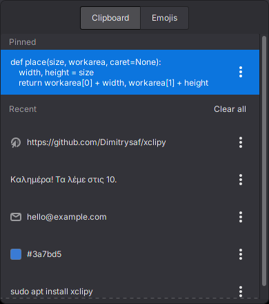
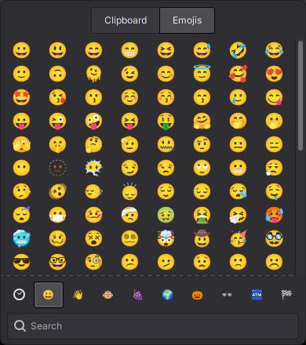
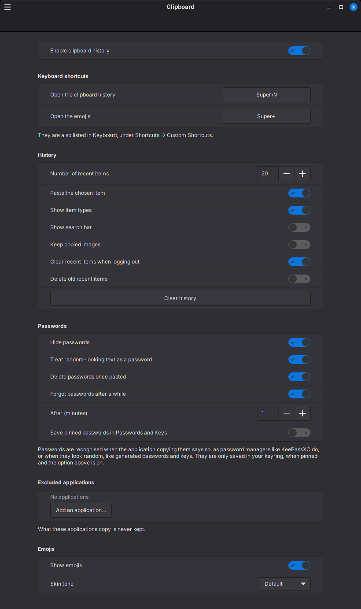

# Xclipy

Clipboard history for the Cinnamon, MATE and Xfce desktops.

 



## Features

### Clipboard history

Super + V opens an overlay with your clipboard history. It opens right under
your text cursor, so your eyes (and your mouse) don't have to travel far.
Choose an item and it's pasted where you were typing.

Items are sorted into types, like links, email addresses, phone numbers,
files, color codes (with a little swatch of the color) and passwords. Passwords
are hidden as •••••••• once recognised, and they only live in memory: they're
gone after a reboot, even if you pin them. If you want pinned passwords to
stick around, turn on saving them to the keyring.

Images can be copied too. Don't want them? Turn them off in the settings. Heck,
you can turn off whatever you like in the settings. Even the clipboard history
itself :)

Anything can be pinned to the top, edited, deleted or pasted from its menu, and
a search bar can join the bottom of the overlay if you like searching more than
scrolling.

### Emojis

Super + . opens the Emojis tab, because sometimes words aren't enough 🙂. Every
emoji is there, in groups, with search, your recently used ones first and the
skin tone you prefer. Never use them? You know the drill: turn them off.

### Keyboard

Your hands never have to leave the keyboard: arrows to move, Enter to choose,
the Menu key (or Shift+F10) for an item's menu, Escape to close, Ctrl+Tab to
switch tabs. While editing, Ctrl+Enter saves and Escape cancels. With the
search bar, just type to search, Down goes back to the list and Escape clears
the search. In the Emojis tab, just type.

### What is saved

The history is kept in your home folder, readable only by you, so it survives
a restart. Passwords never go there. Clear history, in the settings, deletes
everything, pinned items included.

## Architecture

`xclipy` is the application, in Python with GTK 3. It starts at login without a
window (`xclipy --background`, XDG autostart) and watches the clipboard. The
keyboard shortcuts run `xclipy --show` and `xclipy --emoji`, which reach the
running Xclipy over D-Bus (`org.x.Xclipy`, which also starts it if needed) and
open or close the overlay on that tab. `xclipy --settings` opens the settings.

### Watching the clipboard

Xclipy follows the clipboard's owner changes (GTK on X11, the helper on
Wayland) and reads the new content as text or, when images are kept, as an
image. It skips its own copies, and copies made in an excluded application:
the application is the window with the keyboard focus (libwnck on X11, the
helper on Wayland), matched by its window class, application id and program
name. When an application quits, Cinnamon and MATE put back what it had
copied, as plain text; Xclipy remembers the passwords it has seen (as SHA-256
digests, in memory), so a password stays one, and a forgotten one isn't kept
again.

### Recognising passwords and other kinds

- **Passwords** are recognised in two ways (`xclipy/kinds.py`,
  `xclipy/watcher.py`):
  - The copying application marks them: password managers (KeePassXC,
    KWallet, ...) add the `x-kde-passwordManagerHint` target to the
    clipboard.
  - They look random: one word of 8 to 128 characters, mixing at least three
    of lowercase, uppercase, digits and symbols, switching between them
    often, with few runs of three or more of the same class, as words have.
    Links, email addresses, paths, numbers, UUIDs and hashes never count.
    "xK9#mQ2$vL" is a password; "user_name_2" and "Password2024" aren't.
- **Other kinds** are recognised by their text alone, in this order: links
  (`http(s)://`, `ftp://`, `smb://`, `www.`), email addresses, colors (`#rgb`,
  `#rrggbb`, `#rrggbbaa`, `rgb()`, `rgba()`), phone numbers (7 to 15 digits,
  with `+`, `tel:`, brackets or groups; dates aren't), and files and folders
  (a `file://` URI, or a path that exists). Anything else, or anything on
  several lines, is text.

### Passwords

Unless it is pinned, a password is deleted from the history about a second
after it is pasted (once the application has taken it), and taken off the
clipboard too if it's still there. Every 10 seconds, Xclipy forgets passwords older than the set time, and
deletes items older than the set number of days when that is on. A pinned
password is only kept beyond the session if "Save pinned passwords" is on:
it is then stored in the keyring through libsecret (schema
`org.x.Xclipy.Password`, with a random id), and the history file only has that
id. Turning the option off deletes them from the keyring.

### Storage

- The history: `~/.local/share/xclipy/history.json` (newest first, pinned items
  apart, each item with the time it was copied), written atomically, with the
  folder `0700` and the file `0600`. Text over a million characters isn't
  kept.
- Images: PNG files in `~/.local/share/xclipy/images/`, named by a hash of the
  picture, so the same image is stored once; files no item uses are deleted.
- The settings, the recently used emoji and the skin tone: GSettings,
  `org.x.xclipy`.
- At logout the recent items are cleared, when set. The history file also
  records the session, so a session that ended without logging out (a crash, a
  power cut) is cleared at the next login.

### Opening and pasting

- The text cursor's position comes from AT-SPI, the accessibility interface,
  for the focused text field. GTK applications (Text Editor, terminals...)
  give it; the overlay opens in the bottom right corner of the screen for
  those that don't.
- Pasting puts the item on the clipboard and presses Ctrl+V with `xdotool`
  (X11; the helper on Wayland), or Ctrl+Shift+V when AT-SPI says the focused
  application is a terminal.
- The emoji come from Unicode's `emoji-test.txt` (`xclipy/emoji_data.py`) and
  are searched by their English names.

### Desktop integration

- The shortcuts are the desktop's own custom shortcuts, added the first time
  Xclipy runs there, and listed with its other shortcuts (Cinnamon's
  `org.cinnamon.desktop.keybindings`, MATE's `/org/mate/desktop/keybindings/`,
  Xfce's `xfce4-keyboard-shortcuts`). Removed there, they aren't added back. On
  other desktops, bind `xclipy --show` and `xclipy --emoji` yourself.
- The settings are one page (`xclipy/ui/settings_page.py`), shown in
  Cinnamon's System Settings by `cs_xclipy.py` (installed in
  `/usr/share/cinnamon/cinnamon-settings/modules`) and in a window of its own
  elsewhere.
- Xclipy writes to `.xsession-errors`.

### Wayland

Wayland only lets the application with the keyboard focus read the clipboard,
and no application can place its windows or press keys in other applications.
In Cinnamon, a helper extension installed with Xclipy (`xclipy@dimitrysaf`,
turned on the first time Xclipy runs there) does it for Xclipy over D-Bus
(`org.x.Xclipy.Cinnamon`, described in `xclipy/helper.py`). It says when
something is copied and reads it (for Xclipy only), tells which window has the
focus, places the overlay, keeps it out of the window list, and presses
Ctrl+V. Without it (turned off, or on other Wayland desktops), Xclipy only
keeps what is on the clipboard when the overlay opens, choosing an item only
copies it, and applications can't be excluded. On X11 the helper isn't used.

## Building from source

### For Mint with mint-dev-tools

```bash
# Install mint-dev-tools
sudo apt install mint-dev-tools
# Remove any previous versions
sudo apt remove xclipy
# Build and install from github
mint-build -i -g https://github.com/Dimitrysaf/xclipy.git
```

### For Debian distributions (Mint, Ubuntu, etc.) with dpkg-buildpackage

```bash
# Get the source code..
git clone https://github.com/Dimitrysaf/xclipy.git
# Go in..
cd xclipy
# Install the build dependencies..
sudo apt build-dep --mark-auto .
# Remove any previously built packages
rm -f ../xclipy*.deb
# Build
dpkg-buildpackage -us -uc
# Install
sudo apt install ../xclipy*.deb
```

Log out and back in (or run `xclipy --background`), then press Super+V.

### For other distributions with meson

```bash
# Get the source code..
git clone https://github.com/Dimitrysaf/xclipy.git
# Go in..
cd xclipy
```

Install the build and runtime dependencies for your distribution. For example:

```bash
# Fedora: sudo dnf install meson ninja-build python3 gettext
# Arch: sudo pacman -S meson ninja python gettext
# openSUSE: sudo zypper install meson ninja python3 gettext-tools
```

The dependencies are listed below (using debian pkg names, names may be different in your distribution). Install all of them.

#### Dependencies for building

```text
gettext
gtk-update-icon-cache
libglib2.0-bin (for glib-compile-schemas)
meson
python3
```

#### Dependencies for runtime, also needed to run the tests (`meson test`)

```text
gir1.2-gtk-3.0
python3
python3-gi
```

#### Other dependencies for runtime

```text
gir1.2-atspi-2.0
gir1.2-secret-1
gir1.2-wnck-3.0
python3-xapp
xapps-common
xdotool
```

A D-Bus session bus is also required.

Optional:

```text
cinnamon (System Settings → Clipboard, and the helper extension)
fonts-noto-color-emoji (to show the emoji in color)
```

#### Build and install

```bash
meson setup build --prefix=/usr
meson compile -C build
meson test -C build  # optional
sudo meson install -C build
```

System Settings only reads its pages (and Cinnamon its extensions) from
`/usr`, so install with `--prefix=/usr`. With `/usr/local`, the login autostart entry is also
installed in a folder the system doesn't read.

#### Uninstall

To remove a Meson installation while retaining the build directory:

```bash
sudo ninja -C build uninstall
```

## Development

```bash
PYTHONPATH=. python3 -m unittest discover -s tests -t .   # tests
python3 tools/preview.py                                  # the overlay on a sample history
xvfb-run -a python3 tools/preview.py --shots /tmp/shots   # headless screenshots
```

The emoji come from Unicode's `emoji-test.txt`. To update them:

```bash
curl -O https://unicode.org/Public/emoji/latest/emoji-test.txt
python3 tools/update_emoji.py emoji-test.txt
```

## Translations

Xclipy is in English, with a Greek translation. It follows the desktop's
language. Emoji are searched by their English names.

The translation template is `xclipy.pot` and the translations are in `po/`.
After changing interface text, regenerate the template and update the
translations:

```bash
./makepot
msgmerge --update po/el.po xclipy.pot
```

To add a language, create its file from the template, translate it, and add
its code to `po/LINGUAS`:

```bash
msginit --input=xclipy.pot --output=po/fr.po --locale=fr
```

The tests check that every language translates every message, and that the
template is up to date.

## License

Code: GPLv3 or later. See [LICENSES/GPL-3.0.txt](LICENSES/GPL-3.0.txt).
The emoji list is generated from Unicode data, under the
[Unicode License](https://www.unicode.org/license.txt).
